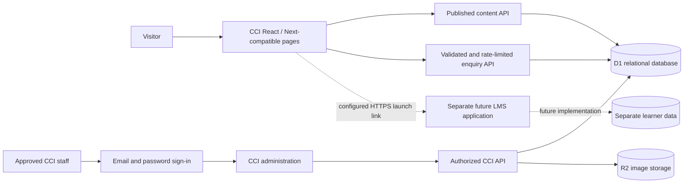

# CCI architecture and product structure

## Delivery boundary

Phase 1 is the CCI organization website and CMS. Phase 2 is a configurable link to the separately deployed Way Way Shaung LMS. Assessment, course delivery, certification, community reports and learner accounts are not implemented or represented as live features in this release.

The attached master prompt and additional design instructions were adopted as the implementation brief at the user's request. The five PDFs supply supporting requirements and commercial context. Quotation terms are reference material: this implementation does not accept contracts, approve commercial changes, invent a delivery date, or treat unresolved questionnaire answers as finalized business rules.

## Sitemap

- `/en`, `/my`: homepage
- `/en/about`, `/my/about`: organization profile
- `/en/initiatives`, `/my/initiatives`: published initiatives
- `/en/initiatives/way-way-shaung`, `/my/initiatives/way-way-shaung`
- `/en/initiatives/cyber-lotus`, `/my/initiatives/cyber-lotus`
- `/en/impact`, `/my/impact`: editorial sections and published evidence-backed metrics
- `/en/contact`, `/my/contact`: contact information and enquiry form
- `/en/privacy`, `/my/privacy`: privacy policy
- `/admin`: authenticated staff workspace
- `/robots.txt`, `/sitemap.xml`: search engine configuration

The public header uses Home, About Us, Our Initiatives, Impact, Contact Us. The language switch retains the selected page. Approved Myanmar body copy is pending; missing translations have an explicit fallback notice. Initial Myanmar interface wording is proposed and needs native-speaker approval.

## System

The implementation uses TypeScript, React, Next-compatible App Router APIs, Vinext/Vite and the supported Sites deployment integration. Cloudflare D1 and R2 replace the recommended PostgreSQL/S3 deployment to match this hosting environment. The data and authorization boundaries remain separate from the future LMS. No unrestricted HTML builder or browser-only content persistence is used.

Public pages are server-rendered. Interaction and editing use client components. The API validates writes, checks staff permissions, protects draft data, and records administrative actions. Staff passwords are salted and hashed. Authentication issues expiring cookies backed by revocable server-side sessions.

## Database

`db/schema.ts` and `drizzle/0000_warm_bastion.sql` define:

| Table     | Purpose                                                                                                  |
| --------- | -------------------------------------------------------------------------------------------------------- |
| content   | Stable ID, content kind, JSON draft snapshot, nullable published snapshot, optimistic version, timestamp |
| staff     | Approved email, role, enabled state                                                                      |
| media     | R2 object ID, original filename, verified MIME type, byte size, alternative text                         |
| enquiries | Name, email, subject, message, status, internal notes and submission timestamp                           |
| audit     | Actor email, action, target and timestamp; no enquiry message bodies                                     |
| limits    | Atomic rate-limit counters and expiry                                                                    |

The CMS supports pages, initiatives, impact metrics and site settings. Publishing copies the saved draft to the public snapshot. Saving alone never updates public content. Unpublishing retains the draft. Internal impact sources and hidden sections are removed from public responses. Record IDs remain stable. Updates use version checks to reject stale edits.

Supported sections contain independent English/Myanmar heading, body and button text, image URL, CTA link, visibility and order. Page composition is controlled: generic editorial sections are sortable; the homepage keeps its main editorial sequence and displays additional sections after the impact preview. This is intentionally not an unrestricted page builder. Partner, testimonial and gallery imagery can be added as approved editorial sections; no fabricated records are seeded.

## Permissions

| Capability                               | Super Administrator | Content Editor | Publisher | Enquiry Manager |
| ---------------------------------------- | ------------------- | -------------- | --------- | --------------- |
| Read content drafts                      | Yes                 | Yes            | Yes       | No              |
| Save content drafts                      | Yes                 | Yes            | Yes       | No              |
| Upload/manage unused media               | Yes                 | Yes            | Yes       | No              |
| Publish/unpublish                        | Yes                 | No             | Yes       | No              |
| Read/change enquiries and internal notes | Yes                 | No             | No        | Yes             |
| Website settings                         | Yes                 | No             | No        | No              |
| Staff access                             | Yes                 | No             | No        | No              |
| Audit history                            | Yes                 | No             | Yes       | No              |
| LMS or learner data                      | No                  | No             | No        | No              |

The site operator configures the first Super Administrator’s email and bootstrap password hash. Staff sign in with email and password, and their role determines which API actions they can perform.

## LMS integration contract

The Way Way Shaung initiative has a stable slug, localized copy, status and approved HTTPS destination. Only `Active` plus a configured URL renders Start Learning. Until then, the page shows Platform coming soon. No iframe, learner credentials, user synchronization or shared CCI staff permissions are used. The future LMS may use `learn.[approved-domain]`; the actual domain is pending.

The future LMS must retain dated assessment history, use client-supplied scoring/character rules and keep privacy-safe share cards separate from private answers. Open lesson browsing/manual completion, configurable quizzes, Bunny.net video, certificates and moderated scam reports belong in a separately approved implementation. Retake timing, scoring thresholds, region/city scope, reward rules, detailed analytics and video seeking behavior remain unresolved. The 5,000-user / 100-session baseline is a future test assumption, not a measured guarantee.

## Design references

Original layouts draw from the hierarchy and editorial rhythm in the supplied [Voices United reference](https://dribbble.com/shots/26183245-Voices-United-Nonprofit-Organization-Website-Design), [NGO reference](https://dribbble.com/shots/25209975-Empowering-Interfaces-UI-UX-Design-for-an-NGO-Website), and GetLayers [Lumora](https://www.getlayers.ai/layer/lumora), [Baseline](https://www.getlayers.ai/layer/baseline), [Noema](https://www.getlayers.ai/layer/noema). The [e-learning reference](https://dribbble.com/shots/27496914-E-Learning-Platform) informs the separate LMS direction only. No proprietary reference graphics are reused. The supplied CCI logo and C2 images are proportionally optimized as WebP. C2 poses are unchanged.
